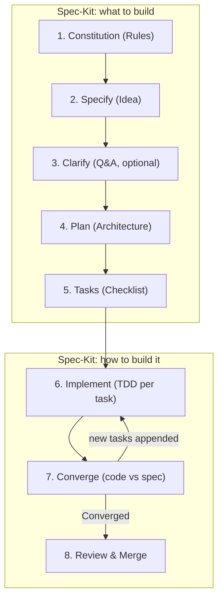
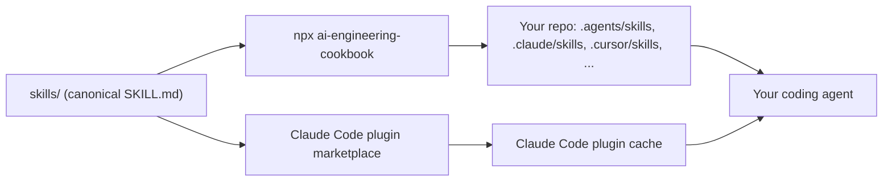

<div align="center">

# AI Engineering Cookbook

**Practical patterns, structures and guardrails for building software with AI agents, with humans in control of intent and outcomes.**

[](https://github.com/exponen-agi/ai-engineering-cookbook/actions/workflows/docs-ci.yml)
[](./LICENSE)
[](./docs/toolchain.md)
[](#installable-skills)
[](https://github.com/github/spec-kit)

[Quickstart](./QUICKSTART.md) · [Browse on the web](https://exponen-agi.github.io/ai-engineering-cookbook/) · [Interactive Explorer](https://exponen-agi.github.io/ai-engineering-cookbook/design/cookbook-explorer.html) · [Glossary](./GLOSSARY.md) · [Contributing](./CONTRIBUTING.md)

[](https://exponen-agi.github.io/ai-engineering-cookbook/design/cookbook-explorer.html)

</div>

## Table of contents

- [What and why](#what-and-why)
- [Key features](#key-features)
- [How the workflow fits together](#how-the-workflow-fits-together)
- [Quick start](#quick-start)
- [Installable skills](#installable-skills)
- [Documentation map](#documentation-map)
- [Learning path](#learning-path)
- [The five principles](#the-five-principles-of-ai-native-engineering)
- [Repository structure](#repository-structure)
- [Glossary: canonical terms](#glossary-canonical-terms)
- [Contributing](#contributing)
- [Security](#security)
- [License](#license)

## What and why

AI-native engineering is a development approach where **AI agents write most of the code**, while humans stay in control by defining clear intent up front and verifying outcomes rigorously. Instead of writing code yourself, you write a precise *specification*; an agent implements it, test by test, under constraints you set. Your role shifts from **code author** to **intent definer and outcomes verifier**.

This cookbook is an opinionated workflow for doing that safely and repeatably. It uses **[Spec-Kit](https://github.com/github/spec-kit)** for the whole loop (planning what to build, executing how to build it, and checking the result against the spec), with **[Superpowers](https://github.com/obra/superpowers)** as an optional TDD discipline layer, plus curated community extensions and an AI governance layer.

> [!TIP]
> New to this? Start with the [Quickstart](./QUICKSTART.md), then follow the [learning path](#learning-path). Unsure about a term? See the [Glossary](./GLOSSARY.md).

## Key features

- **Spec-driven workflow.** Constitution, specify, clarify, plan, tasks, implement, converge. Code is checked against the spec until it converges.
- **Greenfield and brownfield guides.** Worked examples for new projects and for legacy codebases ([Greenfield](./docs/greenfield.md), [Brownfield](./docs/brownfield.md)).
- **Governance layer.** Agent roles, verification gates, execution logs and blameless postmortems ([AI Governance](./docs/governance.md)).
- **Five installable Agent Skills,** each backed by a deterministic CI gate, that work in Claude Code, Cursor, Codex, Copilot, Roo Code, Antigravity and more.
- **Curated community extensions** to strengthen security, scope and testing ([Community Extensions](./docs/extensions.md)).
- **Agent security, tracing and evals** guides for the parts of agent engineering that fail silently.
- **Interactive Explorer** that walks through the whole workflow in a browser.

## How the workflow fits together

Spec-Kit plans the work, executes it with `/speckit-implement`, and checks it with `/speckit-converge`, looping until the code matches the spec. Superpowers, if installed, adds TDD and review discipline inside the implement step.



Skills install into your repository and are read by whichever agent you use:



## Quick start

Requires Node 22 or newer for the skill installers. Set up Spec-Kit and run your first feature by following the [Quickstart](./QUICKSTART.md) (about five minutes); prerequisites are in [Installation & Setup](./docs/installation.md).

Install a skill into your repository:

```bash
npx ai-engineering-cookbook            # interactive menu: pick skills and agent environments
npx ai-engineering-cookbook doc-coherence
npx ai-engineering-cookbook prompt-optimizer --tool cursor
```

Or take every skill in Claude Code:

```text
/plugin marketplace add exponen-agi/ai-engineering-cookbook
/plugin install cookbook-skills@ai-engineering-cookbook
```

## Installable skills

This repo ships portable **[Agent Skills](https://agentskills.io/specification)** (`SKILL.md`) you can drop into any compatible agentic tool. The same skill file works everywhere; only the install folder differs.

Install any skill directly inside your target repository:

```bash
npx ai-engineering-cookbook doc-coherence
npx ai-engineering-cookbook prompt-optimizer
npx ai-engineering-cookbook skill-review
npx ai-engineering-cookbook agent-tracing
npx ai-engineering-cookbook eval-harness
```

Run `npx ai-engineering-cookbook` without arguments for an interactive menu that lets you pick a skill **and** one or more coding-agent environments.

### Marketplace or npx

The Claude Code marketplace route (above) and `npx` differ in who owns the files, and that is the whole trade-off:

| | `npx ai-engineering-cookbook ...` | `/plugin install ...` |
| :--- | :--- | :--- |
| Where the files land | Your repo, committed by you | Claude Code's plugin cache |
| Who can edit them | You; they are yours to change | Read-only; edits are overwritten on update |
| Updates | When you re-run the installer | Managed for you |
| Works in | Every listed agent (Cursor, Codex, Copilot, ...) | Claude Code only |

Use `npx` when you want to adapt a skill to your project. Use the marketplace when you want to subscribe and forget.

### Choosing your coding-agent environment

Skills are not Claude-only. Run the bare command and the installer asks which agent environment(s) you want — you can **multi-select** by entering comma-separated numbers (e.g. `1,3,5`):

| Environment | Project folder | Your-user folder (`--user`) |
| :--- | :--- | :--- |
| **Any agent (recommended)** | `.agents/skills` | `~/.agents/skills` |
| Claude Code | `.claude/skills` | `~/.claude/skills` |
| Cursor | `.cursor/skills` | `~/.cursor/skills` |
| GitHub Copilot (VS Code) | `.github/skills` | `~/.copilot/skills` |
| OpenAI Codex | `.agents/skills` | `~/.agents/skills` |
| Google Antigravity | `.agents/skills` | `~/.gemini/antigravity/skills` |
| Roo Code | `.roo/skills` | `~/.roo/skills` |
| **Others** | `.coding/skills` → rename `.coding/` to your tool's folder after install | — |

**Which should you pick?** If you are unsure, pick **Any agent**. `.agents/skills`
is the shared folder that most agents now read, so one install works in several
tools at once. The vendor folders above still work for the tool that owns them,
and Claude Code reads only its own — so pick **Claude Code** if that is all you use.

> [!NOTE]
> **Codex changed.** OpenAI documents `.agents/skills` as the only project
> location Codex reads; a `.codex/skills` folder is ignored. Earlier versions of
> this installer wrote there, so if you have a `.codex/skills` folder left over,
> delete it — the installer now says so when it finds one.

Pick **Others** for any agent not in the list: the skill lands in a generic `.coding/` folder and the installer tells you to rename it to whatever directory your tool reads. You can also target a specific tool non-interactively with `--tool`:

```bash
npx ai-engineering-cookbook doc-coherence --tool agents    # portable: .agents/skills
npx ai-engineering-cookbook doc-coherence --tool cursor
npx ai-engineering-cookbook prompt-optimizer --tool codex
npx ai-engineering-cookbook prompt-optimizer --tool others   # → .coding/, rename afterward
```

### The skills

| Skill | What it does | Run inside your repo |
| :--- | :--- | :--- |
| **[Prompt Optimizer](./docs/prompt-optimizer.md)** | Turns vague requests into production-grade prompts — framework selection, model calibration, red-team, scorecard. Optional Claude Code session-start gate. | `npx ai-engineering-cookbook prompt-optimizer` |
| **[Doc Coherence](./docs/doc-coherence.md)** | Single-source-of-truth registry + deterministic CI gate that fails the build when one doc restates a fact owned by another. | `npx ai-engineering-cookbook doc-coherence` |
| **[Skill Review](./docs/skill-review.md)** | Vets a whole skill folder before you install, publish or trust it — bundled scripts, spec conformance, portable vs vendor-only fields, risky commands, and characters a reviewer cannot see. Ships a deterministic CI gate. | `npx ai-engineering-cookbook skill-review` |
| **[Agent Tracing](./docs/agent-tracing.md)** | Traces an agent with the OpenTelemetry GenAI conventions — spans for turns, model calls, tool calls and skill loads, plus token cost. Ships a deterministic attribute-name gate. | `npx ai-engineering-cookbook agent-tracing` |
| **[Eval Harness](./docs/eval-harness.md)** | Builds an eval suite that can actually fail — golden dataset, cheapest-scorer ladder, pass-rate threshold. Ships a deterministic CI gate that catches a suite which silently passes everything. | `npx ai-engineering-cookbook eval-harness` |

### Installation fallbacks

If the direct `npx` command fails or you are working in an environment with restricted network access/unresolved binary shims (common with direct GitHub URLs on Windows), choose one of these fallbacks:

#### Option A: Local DevDependency (Recommended)

Install the package locally to your target project. This ensures npm correctly configures binary shims on all operating systems:

```bash
# From npm registry:
npm install --save-dev ai-engineering-cookbook

# OR from GitHub directly:
npm install --save-dev github:exponen-agi/ai-engineering-cookbook

# Run the skill installer:
npx ai-engineering-cookbook doc-coherence
```

#### Option B: Global Installation

Install the CLI tool globally on your system:

```bash
# From npm registry:
npm install -g ai-engineering-cookbook

# OR from GitHub directly:
npm install -g github:exponen-agi/ai-engineering-cookbook

# Run the installer commands:
ai-engineering-cookbook doc-coherence
ai-engineering-cookbook prompt-optimizer
```

*(Alternatively, you can run the direct script shortcuts: `install-doc-coherence` or `install-prompt-optimizer`.)*

## Documentation map

| Guide | Description | Key Focus |
| :--- | :--- | :--- |
| **[Cookbook Explorer](https://exponen-agi.github.io/ai-engineering-cookbook/design/cookbook-explorer.html) ([Local](./design/README.md))** | Interactive visual companion to explore the cookbook. | Interactive SDLC, agents, verification gates, and extensions |
| **[Quickstart Guide](./QUICKSTART.md)** | Start here! Launch your first AI-native feature in 5 minutes. | CLI cheatsheet, 3-step setup |
| **[Installation & Setup](./docs/installation.md)** | Prerequisites and global configuration steps. | uv, specify-cli, plugins |
| **[Greenfield Workflows](./docs/greenfield.md)** | Building new features and applications from scratch. | Next.js Expense Tracker example |
| **[Brownfield Workflows](./docs/brownfield.md)** | Safe development in legacy or existing codebases. | Express.js JWT Auth example |
| **[AI Governance & Observability](./docs/governance.md)** | The SDLC flywheel, logs, postmortems, and agent roles. | reflections, blameless logs |
| **[Community Extensions](./docs/extensions.md)** | 20 curated plugins to enhance security, scope, and testing. | Extension maps, decision guide |
| **[Prompt Optimizer Skill](./docs/prompt-optimizer.md)** | Production prompt engineering skill + optional session-start gate. Install via [Installable Skills](#installable-skills). | Framework selection, model calibration, scorecard |
| **[Context Engineering](./docs/context-engineering.md)** | The 6 Context-Engine principles mapped honestly to this repo's mechanisms. | Conflict resolution, token optimization, scope boundaries |
| **[Agent Standards](./docs/agent-standards.md)** | The three open standards every 2026 agent reads: AGENTS.md, Agent Skills, and MCP. | Progressive disclosure, stateless MCP, per-platform config paths |
| **[Evaluation & Observability](./docs/evaluation-and-observability.md)** | Telling whether the model's output was actually good — traces vs. evals. | Golden datasets, judge calibration, OpenTelemetry GenAI |
| **[Eval Harness Skill](./docs/eval-harness.md)** | Building the eval suite itself, and proving it can fail. Install via [Installable Skills](#installable-skills). | Dataset design, scorer ladder, thresholds, the `check-evals` gate |
| **[Agent Security](./docs/agent-security.md)** | Stopping an agent from being turned against you by the text it reads. | Prompt injection, the lethal trifecta, reviewing a skill before you install it, scanning a skill for invisible instructions |
| **[Doc Coherence Skill](./docs/doc-coherence.md)** | Single-source-of-truth registry + CI gate that flags cross-doc drift. Install via [Installable Skills](#installable-skills). | Canonical owners, authority order, deterministic gate |
| **[Skill Review Skill](./docs/skill-review.md)** | Checking a whole skill folder before you trust it, and writing one that works in every tool. Install via [Installable Skills](#installable-skills). | Bundled scripts, the six portable fields, hidden characters, the `check-skills` gate |
| **[Agent Tracing Skill](./docs/agent-tracing.md)** | Seeing what an agent actually did — spans, token cost, and which skill it loaded. Install via [Installable Skills](#installable-skills). | OTel GenAI conventions, `gen_ai.skill.*`, the `check-semconv` gate |
| **[Troubleshooting](./docs/troubleshooting.md)** | Common failure scenarios and step-by-step fixes. | Install errors, TDD issues, phantom completions |
| **[Toolchain & Node Baseline](./docs/toolchain.md)** | Which Node.js version this repo needs, and why every CI tool is pinned. | Node baseline, pinned CI tools, the `check:toolchain` gate |
| **[Security Policy](./SECURITY.md)** | What counts as a vulnerability here and how to report one privately. | Private reporting, scope, dry-running an installer |
| **[Glossary](./GLOSSARY.md)** | Plain-English definitions for every key term. | 30+ terms from AI Agent to Worktree |
| **[Contributing](./CONTRIBUTING.md)** | How to improve the cookbook and add new content. | PR checklist, style guide, extension submissions |

## Learning path

Not sure where to begin? Follow this sequence:

| Step | You Are... | Go To |
| :---: | :--- | :--- |
| 1 | **Brand new** — never used AI agents for coding | [Quickstart Guide](./QUICKSTART.md) |
| 2 | **Setting up** your local machine | [Installation & Setup](./docs/installation.md) |
| 3 | **Starting a new project** from scratch | [Greenfield Workflow](./docs/greenfield.md) |
| 4 | **Adding AI to an existing project** | [Brownfield Workflow](./docs/brownfield.md) |
| 5 | **Curious about governance** and quality gates | [AI Governance & Observability](./docs/governance.md) |
| 6 | **Want more tools** and plugins | [Community Extensions](./docs/extensions.md) |
| 7 | **Want a sharper prompt** before starting work | [Prompt Optimizer Skill](./docs/prompt-optimizer.md) |
| 8 | **Wondering how agents connect** to tools and data | [Agent Standards](./docs/agent-standards.md) |
| 9 | **Building a feature that calls a model** and need to score it | [Evaluation & Observability](./docs/evaluation-and-observability.md) |
| 10 | **Ready to write the eval suite** and make it block bad merges | [Eval Harness](./docs/eval-harness.md) |
| 11 | **About to connect a tool or install a skill** you did not write | [Agent Security](./docs/agent-security.md) |
| 12 | **Holding a skill folder** and wondering whether it is safe and portable | [Skill Review](./docs/skill-review.md) |
| 13 | **Stuck on something** | [Troubleshooting Guide](./docs/troubleshooting.md) |
| 14 | **Want to contribute** | [Contributing Guide](./CONTRIBUTING.md) |

## The five principles of AI-Native Engineering

In well-structured agentic pipelines, AI agents generate approximately **75% of the implementation code**. This changes the human role from *code author* to *intent definer, outcomes verifier, and system governor*.

We enforce five core principles to manage this shift safely:

1. **Intent First, Code Second**: Code that passes tests but misses design intent is a liability. Clarify intent before generating.
2. **Verify, Don't Just Generate**: Value is measured by spec adherence, not lines produced. A smaller, correct implementation is always preferred.
3. **Precision Over Productivity**: Architectural consistency protects the codebase. Adhere to project guidelines even if they require extra steps.
4. **Observability is Non-Negotiable**: Every coding session must record reflections to feed the continuous learning loop.
5. **Blameless Culture**: Production bugs and gate escapes are system failures. We update spec-rules, check-gates, or prompt-skills to prevent them, rather than blaming the developer or agent.

## Repository structure

```text
.
├── skills/              Canonical source for the five installable Agent Skills
├── docs/                Guides: workflows, governance, security, tracing, evals, toolchain
├── templates/           Copy-ready examples: coherence registry, eval dataset, tracing instrumentation
├── hooks/               Optional Claude Code hook (prompt-optimizer session-start gate)
├── bin/                 npx installer CLI and the single tool-profiles table
├── scripts/             Deterministic CI gates (doc coherence, skills, semconv, evals, hidden chars)
├── test/                node:test suite for the scripts
├── design/              Interactive Explorer (source in design/src, generated bundle checked in)
├── .ai/                 Agent roles, verification guide and execution traces
├── postmortems/         Blameless postmortem and learning log
├── .claude-plugin/      Claude Code plugin marketplace manifest
├── AGENTS.md            Entry point for coding agents
├── CLAUDE.md            Rules agents follow in this repo
├── QUICKSTART.md  GLOSSARY.md  CONTRIBUTING.md  SECURITY.md  LICENSE
└── package.json
```

## Glossary: canonical terms

To prevent the same concept being called different things across docs, these are the canonical names. Use them exactly; everything else points here.

| Term | Means | Not to be confused with |
| :--- | :--- | :--- |
| **Spec-Kit** | The product/methodology for spec-driven development. | — |
| **specify-cli** | The CLI package that installs Spec-Kit (`uv tool install specify-cli`). | the `/speckit-*` skills |
| **`.specify/`** | The directory Spec-Kit creates for specs, plans, tasks, and constitution. | specify-cli (the tool) |
| **`/speckit-*`** | The Spec-Kit **agent skills** you type in your agent's chat (`/speckit-specify`, `/speckit-plan`, …). The prefix varies by agent — see [Installation](./docs/installation.md#the-prefix-depends-on-your-agent). | specify-cli (the tool); terminal commands |
| **Superpowers** | An optional agent plugin (`/plugin install superpowers@…` in Claude Code) whose TDD/worktree/review skills trigger inside `/speckit-implement`. Never a second executor. | this repo's local `skills/` |
| **The Five Principles** | The *philosophy* (why) — authored in this README. | the Five Directives |
| **The Five Directives** | The *operational rules* (how) — authored in [CLAUDE.md](./CLAUDE.md) §5. | the Five Principles |
| **`skills/`** | Canonical source for this repo's installable skills. | `.claude/skills/` (generated install output — never hand-edited) |

## Contributing

Contributions are welcome. Read the [Contributing Guide](./CONTRIBUTING.md) before submitting a PR; it covers branch naming, the style guide, how to add new extensions or skills, and the PR checklist. Run the full pipeline from [AGENTS.md](./AGENTS.md) before you commit.

## Security

See [SECURITY.md](./SECURITY.md) for what counts as a vulnerability here and how to report one privately.

## License

Released under the [MIT License](./LICENSE). You are free to use, copy, modify and redistribute it, including commercially, as long as the copyright notice and license text travel with it.
